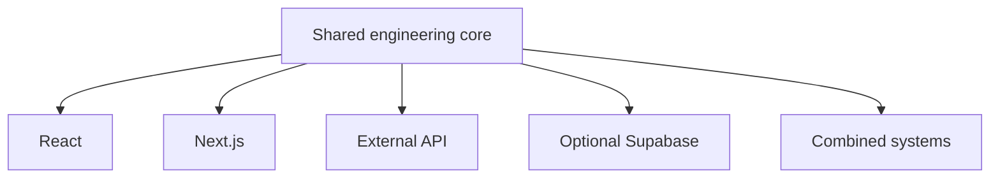
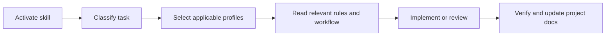

# Web Engineering Skills

An installable Agent Skill for AI coding agents that plan, build, maintain and review web applications. It gives agents decision workflows, stable engineering rules, task routing, templates and neutral examples they can consult as needed.

| Profile | Use it for |
| --- | --- |
| React | Internal tools, administrative dashboards and client-rendered applications |
| Next.js | Public websites, landing pages, SEO, localization and authenticated applications |
| External API | Existing REST contracts, data access, validation and failure handling |
| Optional Supabase | Schema changes, identity, authorization, storage and service integration |
| Combined systems | Public and staff applications with shared contracts and separate trust boundaries |

The skill starts with requirements and material unknowns. It compares frontend and backend options, asks for approval where the decision changes the stack, and adapts to established project conventions. Feature guidance covers UI and design systems, security, testing and living documentation.

## Install and start

Use the [installation guide](docs/INSTALLATION.md) with the complete `web-engineering` directory. Use the versioned ZIP from the [v0.1.0 release](https://github.com/AhmadMriwed/web-engineering-skills/releases/tag/v0.1.0) or install from the repository checkout.

In Codex, try `$web-engineering Help me choose the stack for an internal inventory dashboard with an existing REST API. Ask about any material unknowns before scaffolding.` You can also describe the task in natural language. See [usage examples](docs/USAGE.md) for greenfield and existing-project work.

## Verification

The frozen skill has 20 stable rules, 29 named task routes and 52 runtime files. Independent Codex CLI trials observed explicit invocation, automatic use and reference reads. Five independent project scenarios had passing implementation checks within their tested scope. Managed Supabase, deployed authorization and Claude Code execution remain unverified. See the [validation summary and compatibility matrix](docs/PUBLIC_VALIDATION.md).

## Repository

- [Skill](web-engineering/SKILL.md) and [reference index](web-engineering/references/index.md) are the agent-facing materials.
- [Distribution](docs/DISTRIBUTION.md) defines the package boundary and reproducible local build.
- [Development history](docs/PHASE_6.md), [roadmap](ROADMAP.md) and [changelog](CHANGELOG.md) record progress.
- [Contribution guide](CONTRIBUTING.md) and [security policy](SECURITY.md) explain how to propose changes and report issues.

Licensed under [Apache-2.0](LICENSE). See [NOTICE](NOTICE) for attribution.

See the [v0.1.0 publication record](docs/PUBLICATION.md) for archive integrity details.
